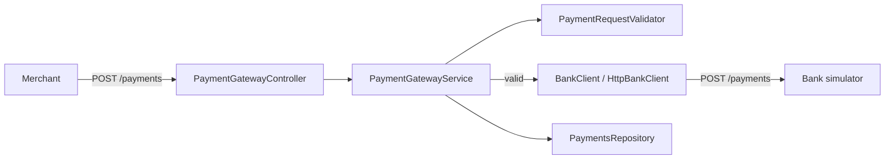

# Payment Gateway

A payment gateway API that lets merchants process card payments and retrieve them later. Payments are authorised through an acquiring bank, simulated here by the provided Mountebank bank simulator.

Built with Java 17 and Spring Boot 3.1.

---

## Quick start

### Prerequisites
- JDK 17
- Docker

### Run everything with Docker (gateway + bank simulator)
```bash
docker-compose up --build
```
- Gateway: `http://localhost:8090`
- Bank simulator: `http://localhost:8080`

### Run the gateway locally (simulator in Docker)
```bash
docker-compose up bank_simulator
./gradlew bootRun
```

### Run the tests
```bash
./gradlew test
```

### Useful URLs
| What | URL |
|---|---|
| Swagger UI | http://localhost:8090/swagger-ui/index.html |
| Health | http://localhost:8090/actuator/health |
| Metrics | http://localhost:8090/actuator/metrics/payments.processed |

---

## API

### Process a payment: `POST /payments`

**Request**
```json
{
  "cardNumber": "2222405343248877",
  "expiryMonth": 4,
  "expiryYear": 2027,
  "currency": "GBP",
  "amount": 1050,
  "cvv": "123"
}
```
`amount` is in the minor currency unit (e.g. 1050 = £10.50).

**Responses**

| Outcome | HTTP status | When |
|---|---|---|
| Authorized | `201 Created` | The bank authorised the payment |
| Declined | `201 Created` | The bank declined the payment |
| Rejected | `400 Bad Request` | The request failed validation. The bank is not called and nothing is stored |
| Bank unavailable | `502 Bad Gateway` | The bank returned an error or couldn't be reached. Nothing is stored |

**Authorized / Declined (201)**
```json
{
  "id": "6f1c2a8e-3b4d-4e5f-9a1b-2c3d4e5f6a7b",
  "status": "Authorized",
  "cardNumberLastFour": "8877",
  "expiryMonth": 4,
  "expiryYear": 2027,
  "currency": "GBP",
  "amount": 1050
}
```

**Rejected (400)**: all validation errors are returned at once.
```json
{
  "status": "Rejected",
  "message": "Payment rejected",
  "errors": ["cardNumber must be 14-19 digits", "cvv must be 3-4 digits"]
}
```

**Bank unavailable (502)**
```json
{
  "message": "The acquiring bank is unavailable. Please try again later.",
  "errors": []
}
```

### Retrieve a payment: `GET /payments/{id}`

| Outcome | HTTP status |
|---|---|
| Found | `200 OK`, same body as the 201 response above |
| Not found | `404 Not Found`, `{"message": "Payment not found", "errors": []}` |
| Id is not a valid UUID | `400 Bad Request` |

### Try it with curl
The simulator's response depends on the card number's last digit:

| Last digit | Bank response | Gateway result |
|---|---|---|
| 1, 3, 5, 7, 9 | Authorised | `201 Authorized` |
| 2, 4, 6, 8 | Not authorised | `201 Declined` |
| 0 | `503 Service Unavailable` | `502 Bad Gateway` |

```bash
# Authorized
curl -i -X POST http://localhost:8090/payments -H "Content-Type: application/json" \
  -d '{"cardNumber":"2222405343248877","expiryMonth":4,"expiryYear":2027,"currency":"GBP","amount":1050,"cvv":"123"}'

# Declined
curl -i -X POST http://localhost:8090/payments -H "Content-Type: application/json" \
  -d '{"cardNumber":"2222405343248878","expiryMonth":4,"expiryYear":2027,"currency":"GBP","amount":1050,"cvv":"123"}'

# Bank unavailable
curl -i -X POST http://localhost:8090/payments -H "Content-Type: application/json" \
  -d '{"cardNumber":"2222405343248870","expiryMonth":4,"expiryYear":2027,"currency":"GBP","amount":1050,"cvv":"123"}'

# Rejected
curl -i -X POST http://localhost:8090/payments -H "Content-Type: application/json" \
  -d '{"cardNumber":"1234","expiryMonth":13,"expiryYear":2020,"currency":"JPY","amount":0,"cvv":"12"}'

# Retrieve (use an id from a previous response)
curl -i http://localhost:8090/payments/<id>
```

### Validation rules

| Field | Rules |
|---|---|
| `cardNumber` | Required; 14–19 characters; digits only |
| `expiryMonth` | Required; 1–12 |
| `expiryYear` | Required; month + year must not be in the past |
| `currency` | Required; 3 characters; one of `GBP`, `USD`, `EUR` |
| `amount` | Required; positive integer (minor units) |
| `cvv` | Required; 3–4 characters; digits only |

---

## Design

### How a payment flows

1. The controller passes the request to the service.
2. The service validates it. If invalid, it throws `PaymentRejectedException`, which becomes a `400 Rejected`. The bank is not called.
3. The request is mapped to the bank's format and sent through `BankClient`.
4. `authorized: true` maps to **Authorized** and `false` to **Declined**.
5. The payment is stored with only the last four card digits and returned.
6. If the bank call fails, `BankUnavailableException` becomes a `502` and nothing is stored.

### Package structure
| Package | Responsibility |
|---|---|
| `controller` | HTTP endpoints |
| `service` | Payment processing logic |
| `validation` | Request validation rules |
| `client` | Bank integration: `BankClient` interface, HTTP implementation, bank request/response models |
| `entity` | `Payment`, the stored payment |
| `repository` | In-memory payment storage |
| `model` | API request/response models |
| `exception` | Domain exceptions and the global exception handler |
| `observability` | Payment metrics |
| `configuration` | Spring beans (`RestTemplate`, `Clock`) |

### Key decisions
- **Separate merchant and bank models.** `PostPaymentRequest` is the gateway's contract with merchants (camelCase, separate expiry month and year). `BankPaymentRequest` is the bank's contract (snake_case, zero-padded `MM/YYYY` expiry). Either side can change without breaking the other, and format conversion happens in one place.
- **`BankClient` interface.** The service depends on an interface rather than the HTTP implementation, so it can be unit tested with a mock and the bank integration can be swapped.
- **Separate `Payment` entity.** Storage is decoupled from the API response models, so the API can change without changing what's stored.
- **Validation collects every error.** A plain validator class returns all errors at once, so merchants can fix everything in one go. It uses an injected `Clock` so expiry checks are deterministic in tests.
- **Card number and CVV are Strings.** A 16–19 digit card number doesn't fit in an `int`, a CVV like `012` would lose its leading zero, and the rules are about characters (length, digits only).
- **Status codes.** Authorized and Declined both return `201`, because in both cases the payment was processed and stored. A decline is a valid business outcome, not an error. Rejected returns `400` and is not stored, because "no payment could be created". Bank failures return `502` because the problem is upstream, not the merchant's request.
- **Bank failures aren't stored.** The required statuses are Authorized, Declined and Rejected, and a bank failure is none of these. Rather than inventing a fourth status, the gateway returns `502` and the merchant can retry.
- **One error shape.** Every error uses the same body (`status`, `message`, `errors`), so merchants only need to handle one format. `status` only appears when a payment is rejected.
- **Card data safety.** Only the last four digits are stored and returned. The full card number and CVV are never stored, and `toString()` methods mask them so they can't end up in logs.
- **Thread-safe storage.** The repository uses a `ConcurrentHashMap` because requests are handled concurrently.
- **Bank call timeouts.** The `RestTemplate` has 10-second connect and read timeouts, so a hung bank call can't hold a request thread indefinitely.

### Assumptions
- Only `GBP`, `USD` and `EUR` are supported (the brief asks for no more than 3), and codes must be uppercase.
- `amount` must be greater than 0.
- A card is valid until the end of its expiry month, so the current month is accepted. The current date is taken in UTC.
- Card numbers must be digits only. Spaces or dashes are rejected rather than stripped.
- A bank `400` shouldn't happen because requests are validated first. If it does, it's treated as a bank failure (`502`).
- Declined payments are stored and retrievable. Rejected and bank-failed payments are not.
- No merchant authentication. Any caller can create or retrieve any payment.

---

## Observability
- **Logs:** each processed payment is logged with its id and status, and each bank call with its latency and result. Bank failures are logged at `WARN`. Card numbers and CVVs are never logged.
- **Metrics:** a `payments.processed` counter tagged by status (`authorized`, `declined`, `rejected`), exposed at `/actuator/metrics/payments.processed` (e.g. `?tag=status:declined`).
- **Health:** `/actuator/health`.

In production I'd alert on a drop in the authorised rate, a rise in bank failures, and bank latency.

---

## Packaging and hosting
- **Dockerfile:** multi-stage. A JDK image builds the jar with the Gradle wrapper, and a smaller JRE image runs it, with no build tools or source in the final image. Dependencies are downloaded in a separate layer so rebuilds are faster.
- **docker-compose:** runs the gateway alongside the bank simulator. The gateway reaches the simulator at `http://bank_simulator:8080`.
- **Configuration:** the bank URL comes from the `BANK_SIMULATOR_URL` environment variable, defaulting to `http://localhost:8080`.
- **CI:** a GitHub Actions workflow runs the tests on every push and pull request and uploads the test report if they fail.

**In production** I'd run the container on a platform such as ECS or Kubernetes behind a load balancer, with several instances, health checks, rolling or canary deployments, and configuration and secrets injected from the environment. The in-memory repository would first need replacing with a shared database, since each instance currently has its own storage.

---

## Testing
| Layer | Test class | What it covers |
|---|---|---|
| Validation (unit) | `PaymentRequestValidatorTest` | Every rule, boundary values (14 and 19 digits, current-month expiry), multiple errors at once, card data masking |
| Service (unit) | `PaymentGatewayServiceTest` | Authorized, Declined, Rejected without calling the bank, bank failure stores nothing, bank request mapping, metrics, retrieval |
| Bank client | `HttpBankClientTest` | Exact JSON sent to the bank, authorised/declined mapping, 503/400/timeout/connection errors, card data masking |
| API (integration) | `PaymentGatewayControllerTest` | Full HTTP flow with a mocked bank: 201 Authorized/Declined, 400 Rejected, 502, 404, invalid UUID, health and metrics endpoints |

The controller tests use a mocked `BankClient`, so the suite runs without Docker. The real simulator can be exercised with the curl examples above.

---

## Changes to the starter code
- `PostPaymentRequest` held only the last four card digits as an `int`. It now holds the full card number and CVV as Strings, uses nullable fields so missing values can be validated, and masks card data in `toString()`.
- Added the missing `POST /payments` endpoint and implemented payment processing, which previously returned a random id.
- Added validation, so **Rejected** can be produced.
- Added the bank client.
- `GET` now returns `GetPaymentResponse` (previously `PostPaymentResponse`), and endpoints use the plural `/payments`.
- The repository now stores a `Payment` entity in a thread-safe `ConcurrentHashMap` (previously a `HashMap` of API response objects).
- Last four digits are now a String, so leading zeros are kept (e.g. `0123`).
- Not-found errors use a specific `PaymentNotFoundException` and return "Payment not found".

---

## What I'd do next for production
- **Idempotency keys:** accept an `Idempotency-Key` header so a retried request can't charge the shopper twice.
- **Uncertain outcomes:** if the bank times out, the payment may still have been authorised. I'd record it as pending and reconcile with the bank rather than treating it as failed.
- **Resilience:** a circuit breaker on the bank client, and retries only where they're safe (with idempotency).
- **Persistent storage:** a database, so payments survive restarts and the service can scale horizontally.
- **Authentication and merchant scoping:** API keys (stored hashed), and only letting merchants retrieve their own payments.
- **Card data security:** tokenisation and encryption at rest, to reduce PCI scope.
- **Observability:** correlation IDs and distributed tracing, bank latency and error metrics, dashboards and alerts.
- **API:** a `Location` header on created payments, API versioning, rate limiting, and currency-specific rules (e.g. JPY has no minor unit).
- **Delivery:** end-to-end tests against the simulator in CI, a Docker build in CI, container hardening (non-root user, health checks) and graceful shutdown.

---

## AI usage
I used Claude Code to speed up writing and fixing tests, and reviewed all the tests myself. The design and application code are my own.